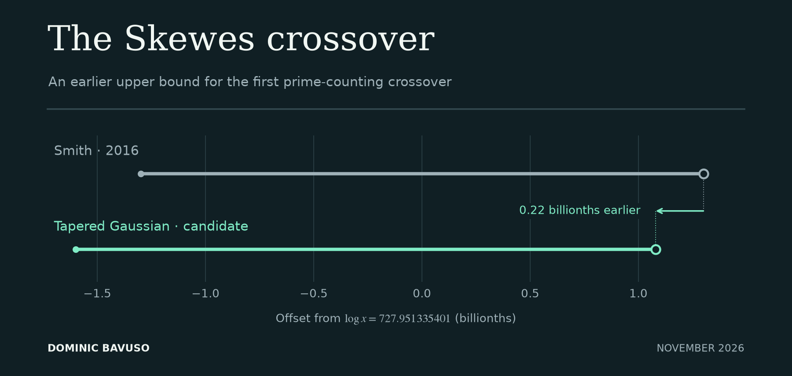

**Dominic Bavuso** · November 2026

[Read the proof](tapered-bound.md) · [Reproduce the calculation](#reproduce-the-calculation) · [Explore the search](experiments.md)

## The result

Let $\pi(x)$ count the primes up to $x$, and let $\operatorname{li}(x)$ be the logarithmic integral, a smooth estimate of that count. How early can we prove the actual count overtakes the estimate?

Using the published zero sum of Smith and Platt, the tapered Gaussian argument gives a point with $\pi(x)>\operatorname{li}(x)$ in the interval

$$
\boxed{727.95133539940 \;\leq\; \log x \;\leq\; 727.95133540208.}
$$

The right endpoint moves the upper bound for the first crossover earlier by $2.2\times10^{-10}$ on the log scale compared with Smith’s 2016 thesis. The argument uses the verified locations of zeta zeros through height $3\times10^{12}$ and bounds the contribution of higher zeros. [Smith, Theorem 9.1](https://etheses.whiterose.ac.uk/id/eprint/16409/) · [Platt and Trudgian, Theorem 1](https://arxiv.org/abs/2004.09765)

> [!NOTE]
> **Verification status.** The interval replay passes using the published sum. An independent reconstruction of that sum, external review of the derivation, and a literature priority check remain open. The exact first crossover is unknown.

## How the bound works

The proof takes a weighted average of the difference between the real and estimated prime counts, rescaled by $\log(x)/\sqrt{x}$. The weight is nonnegative and fades smoothly to zero at both endpoints. The taper preserves most of the Gaussian zero sum and controls the contribution of very high zeros. A positive average forces at least one point in the interval to have $\pi(x)>\operatorname{li}(x)$. [Derivation and taper figure](tapered-bound.md) · [Revers’s explicit formula](https://arxiv.org/html/2501.04488v2#S4)

## Reproduce the calculation

With Python 3.12, run the interval replay to check the error budget against the published zero sum. It requires no zero-table downloads and certifies a positive margin greater than $3.26\times10^{-5}$ from the cited inputs.

~~~sh
python -m pip install mpmath
python tapered.py
~~~

The full audit sums **103,800,788,359** archived zeta zeros with an independent implementation. It verifies each input file and saves a checkpoint after processing it. [Full audit instructions](audit.md) · [LMFDB zero archive](https://www.lmfdb.org/zeros/zeta/)

## Research notes

| Note | What it covers |
| :--- | :--- |
| [Tapered Gaussian bound](tapered-bound.md) | The weight, the error estimates, and the endpoint comparison |
| [Independent numerical audit](audit.md) | Archive checks, arithmetic error bounds, and the resumable replay |
| [Earlier crossover search](experiments.md) | A candidate at $\log x\approx727.951332982$ and the results from 158.2 million zeros |
| [Lower-bound calculation](lower-bound.md) | A finite sieve excludes a short interval immediately above $10^{20}$ |

Finding the exact first crossover would require excluding every earlier value. The gap between the verified lower range and the upper bound near $10^{316}$ remains open.
