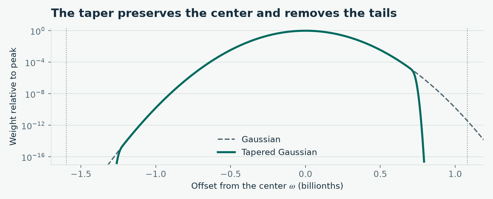

# A Skewes upper bound from a tapered Gaussian

**Dominic Bavuso** · November 21, 2026

## Result

Using the published zero sum of Smith and Platt, there exists an $x$ with $\pi(x)>\mathrm{li}(x)$ and

$$
727.95133539940\le \log x\le 727.95133540208.
$$

The upper endpoint is $2.2\times10^{-10}$ lower on the log scale than Smith's Theorem 9.1. This argument uses finite RH verification. The interval extends further to the left than Smith's. The exact first crossover, independent review, and priority remain open. [Smith, Sections 8–9 and Appendix C](https://etheses.whiterose.ac.uk/16409/1/The%20hunt%20for%20Skewes%27%20number.pdf) · [Platt and Trudgian, Theorem 1](https://arxiv.org/abs/2004.09765)

## Weight and published input

Take $\omega=727.951335401$, $\alpha=4.5\times10^{19}$, $T=30{,}610{,}046{,}000$, and $A=3\times10^{12}$. Platt and Trudgian verify the critical line through $A$. Set $K(s)=k_0 e^{-\alpha s^2/2}$, $k_0=\sqrt{\alpha/(2\pi)}$. The combined negative zero sum of Smith's equations (49) and (50), with $M=T$, is

$$
Z=-\sum_{0<|\gamma|\le T}
\left(\frac1{\rho}+\frac1{\omega\rho^2}\right)e^{i\gamma\omega-\gamma^2/(2\alpha)}.
$$

Smith's Table 4 gives $1.00288049783641096204$ at this center. The replay uses $Z>1.0028804978364$ as a published numerical input. The 103,800,788,359-zero sum has yet to be independently recomputed here. [Smith, Sections 8–9 and Appendix C](https://etheses.whiterose.ac.uk/16409/1/The%20hunt%20for%20Skewes%27%20number.pdf)

Choose $L=1.60\times10^{-9}$, $R=1.08\times10^{-9}$, and taper width $d=0.71\times10^{-9}$. Let $U$ be the sum of $m=391$ independent uniforms on $[-d/(2m),d/(2m)]$. Put $h_L=L-d/2$, $h_R=R-d/2$, and $C(s)=\Pr(-h_L\le s-U\le h_R)$. The weight $W(u)=K(u-\omega)C(u-\omega)$ is nonnegative, supported on $[l,b]=[\omega-L,\omega+R]$, and has mass at most one.

*The dotted lines mark the support endpoints. The vertical scale shows how little Gaussian mass lies near the taper.*

## Keeping the Gaussian sum

Write $D=\int_{\mathbb R}K(s)(1-C(s))\,ds$. This is the probability that $G-U$ lies outside $[-h_L,h_R]$, where $G$ is independent and normal with variance $1/\alpha$. The moment generating function of $U$ is at most $\exp(t^2d^2/(24m))$ since $\sinh y/y\le\exp(y^2/6)$ follows termwise from $(2j+1)!\ge 6^j j!$. Dropping the factor $e^{-\alpha U^2/2}\le1$ in the convolution density gives

$$
f_{G-U}(s)\le k_0e^{-c s^2/2},
\qquad c=\alpha\bigl(1-\alpha d^2/(12m)\bigr)>0.
$$

Integrating each tail using $1\le s/h$ for $s\ge h>0$ gives $D\le\sum_{h\in\{h_L,h_R\}} k_0 e^{-ch^2/2}/(ch)$.

Integrate Revers's (4.10) against $W$, using the smoothed explicit formula as in (5.1). The bounded convergence there also applies after multiplication by $C$, which is bounded on the integration interval. The resulting integrated series is absolutely convergent by the bounds below. The terms from (5.2) and (5.6) are bounded by $R_1$ and $R_5$ evaluated with endpoints $l,b$, using $\int W\le1$. For $|\gamma|\le A$ expand (4.12) through the second term. Freezing $1/u$ at $1/\omega$ costs at most

$$
E_{\mathrm{recip}}=\frac{L+R}{l\omega}\,2(0.0231050).
$$

After freezing, replacing $W$ by the full Gaussian in the critical-line terms costs at most

$$
E_{\mathrm{mass}}=D\left[\frac{\log^2(A/(2\pi))}{2\pi}+2(0.9321)+\frac{2(0.0231050)}{\omega}\right].
$$

These bounds use Revers's Lemmas 4.7(b) and 4.8 and both signs of each ordinate. The Fourier transform of the full Gaussian recovers the published weighting. Extending the absolute bound for the Gaussian tail to all positive ordinates above $T$ gives the same $R_4$ as Revers (5.5), using $1/\gamma+1/(\omega\gamma^2)$ as a majorant wherever $T<\gamma\le A$. [Revers, Sections 4–5](https://arxiv.org/html/2501.04488v2#S4)

## Controlling zeros above the verified height

Write $n=m-1=390$, $\lambda=2m/d$, and use $r=0.42\times10^{-9}$. The cutoff $C$ is the convolution of an interval indicator with $m$ uniform densities. Differentiating $j\le n$ different density factors gives signed measures of total variation $\lambda$ each, so $\|C^{(j)}\|_\infty\le\lambda^j$. At least one undifferentiated density remains. Translation continuity in $L^1$ for that density gives continuous derivatives after convolution with the bounded indicator. These derivatives are compactly supported, so the boundary terms through order $n-1$ vanish.

For $|\gamma|>A$ let $F_\rho(z)=\rho z e^{-\rho z}\mathrm{li}(e^{\rho z})e^{-\alpha(z-\omega)^2/2}$ as in Revers §5.2. On each radius-$r$ disk centered at $u\in[l,b]$, $F_\rho$ is analytic by (4.11). In fact $|\mathrm{Im}(\rho z)|\ge|\gamma|\mathrm{Re}(z)-r$, and $r<l/5$, $A>4$ ensure $|\mathrm{Im}(\rho z)|\ge|\rho z|/2$. By (4.12) with one term,

$$
|F_\rho(z)|\le B=\left(1+\frac4{A(l-r)}\right)e^{\alpha r^2/2}.
$$

Cauchy's estimate gives $|F_\rho^{(j)}(u)|\le Bj!/r^j$. Applying the product rule to $C(u-\omega)F_\rho(u)$ gives

$$
|(C F_\rho)^{(n)}|\le B\lambda^n\sum_{j=0}^n\frac{n!}{(n-j)!(\lambda r)^j}
\le \frac{B\lambda^n}{1-n/(\lambda r)}.
$$

Integrate each zero term by parts $n$ times against $e^{(\rho-1/2)u}$. Use $|\rho-1/2|\ge|\gamma|$, $|\rho|\ge|\gamma|$ and $|e^{(\rho-1/2)u}|\le e^{b/2}$. The resulting bound per signed ordinate is $k_0 e^{b/2}(L+R)B\lambda^n/[(1-n/(\lambda r))|\gamma|^{n+1}]$. Lemma 4.7(a) gives the total

$$
E_{\mathrm{high}}\le
\frac{2\log(A)\,k_0 e^{b/2}(L+R)B}{1-n/(\lambda r)}
\left(\frac{\lambda}{A}\right)^n.
$$

This bound allows any real part $0<\mathrm{Re}\rho<1$ for the zeros above $A$. [Revers, Lemma 4.7 and §5.2](https://arxiv.org/html/2501.04488v2#S5.SS2)

## Arithmetic check

The [interval replay](tapered.py) checks the following bound.

$$
\begin{aligned}
I_W &:= \int_l^b W(u)\,u e^{-u/2}
       \bigl(\pi(e^u)-\mathrm{li}(e^u)\bigr)\,du \\
    &\ge Z-1-R_1-R_4-R_5-E_{\mathrm{recip}}-E_{\mathrm{mass}}-E_{\mathrm{high}} \\
    &> 3.26\times10^{-5}.
\end{aligned}
$$

| Error term | Upper bound |
| --- | ---: |
| Prime-side allowance | $2.762686\times10^{-3}$ |
| Mass removed by the taper | $7.460\times10^{-5}$ |
| Replacing $1/u$ by $1/\omega$ | $2.34\times10^{-16}$ |
| Gaussian zero tail | $1.02661\times10^{-5}$ |
| Exponential-integral remainder | $5.662\times10^{-9}$ |
| Zeros above the verified height | $3.150\times10^{-7}$ |

Since $W$ is nonnegative, $I_W>0$ implies a point of positivity in $[l,b]$.

The separate candidate at $\log x\approx727.951332982$ stays open. This analysis improves the upper endpoint around Smith's confirmed signal. Applying it to the earlier signal requires its actual center, Gaussian width, both zero cutoffs, and the weighted sum or its enclosure. [Smith, Section 10](https://etheses.whiterose.ac.uk/16409/1/The%20hunt%20for%20Skewes%27%20number.pdf)
